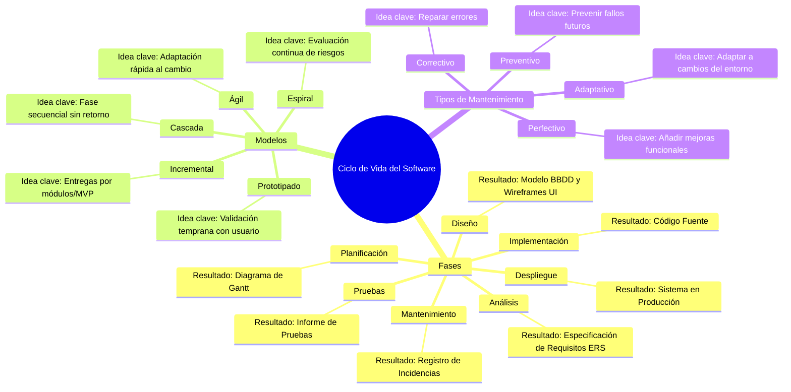

# E04 · Las fases de un proyecto (Polideportivo Los Álamos)

## Requisitos

### Requisitos Funcionales
| ID | Descripción | Método de comprobación / Criterio de aceptación |
| --- | --- | --- |
| **RF1** | El sistema debe permitir reservar pistas (4 de pádel, 2 de tenis y 1 de fútbol sala) en tramos de 1 hora entre las 9:00 y las 22:00. | Intentar realizar una reserva de 1 hora en cada tipo de pista dentro del horario permitido y verificar que queda registrada en la base de datos. |
| **RF2** | El sistema debe impedir que un usuario tenga más de dos reservas pendientes simultáneamente. | Intentar realizar una tercera reserva con un usuario que ya tiene dos activas; el sistema debe mostrar un mensaje de rechazo y bloquear la operación. |
| **RF3** | El sistema debe aplicar la tarifa con descuento a los usuarios empadronados y la tarifa general a los no empadronados. | Crear una reserva con un DNI empadronado y comprobar que calcula el precio reducido, y repetir con un DNI no empadronado verificando el precio estándar. |
| **RF4** | El sistema debe proporcionar una vista diaria de ocupación de pistas para el personal del polideportivo. | Iniciar sesión como administrador/operador y comprobar que el cuadrante del día muestra las pistas reservadas y las libres en tiempo real. |
| **RF5** | El sistema debe impedir las reservas duplicadas en la misma pista y tramo horario. | Intentar reservar una pista y hora previamente ocupadas desde dos navegadores distintos; el sistema debe denegar la segunda solicitud. |

### Requisitos No Funcionales
| ID | Descripción | Método de comprobación / Criterio de aceptación |
| --- | --- | --- |
| **RNF1** | **Seguridad / Normativa (RGPD):** El sistema debe cifrar los datos personales (nombre, DNI, teléfono) en reposo y en tránsito (HTTPS) cumpliendo la LOPDGDD/RGPD. | Inspeccionar las peticiones de red para verificar el uso de HTTPS y comprobar mediante consulta a la base de datos que los datos sensibles están cifrados. |
| **RNF2** | **Rendimiento:** El tiempo de respuesta de la pantalla de consulta de pistas libres no debe superar los 2 segundos con 50 usuarios concurrentes. | Realizar una prueba de carga simulando 50 usuarios simultáneos haciendo peticiones y medir que la latencia media sea ≤ 2 s. |
| **RNF3** | **Usabilidad / Multiplataforma:** La interfaz debe ser web adaptativa (responsive), permitiendo la navegación en navegadores móviles (iOS/Android) y escritorio sin desbordamiento horizontal. | Cargar la aplicación en dispositivos móviles de 375px de ancho y monitores de 1920px y verificar la correcta maquetación mediante inspección visual y tests automatizados. |

---

## Fases del desarrollo

| Fase | Actividades concretas del proyecto | Resultado que saldrá |
| --- | --- | --- |
| **1. Planificación** | Definir el alcance para el MVP de verano (4 meses), repartir tareas entre el equipo de 3 desarrolladores y elaborar el cronograma de trabajo. | Documento de planificación del proyecto y diagrama de Gantt. |
| **2. Análisis** | Entrevistar al concejal de Deportes y al personal del polideportivo para detallar reglas de negocio y definir los campos obligatorios del registro (DNI, teléfono). | Documento de especificación de requisitos de software (ERS). |
| **3. Diseño** | Diseñar la base de datos (tablas de usuarios, pistas y reservas) y elaborar un prototipo de alta fidelidad (wireframes) de la pantalla de reservas para que lo revise el personal. | Modelo entidad-relación y maquetas navegables de la interfaz (UI/UX). |
| **4. Implementación** | Programar la lógica de reserva con el límite de 2 reservas por usuario, desarrollar el panel de control del personal y la integración opcional del pago. | Código fuente de la aplicación web e historial de commits en el repositorio. |
| **5. Pruebas** | Ejecutar pruebas unitarias del algoritmo de tarifas (empadronados vs no empadronados) y realizar pruebas de usabilidad con el personal del polideportivo. | Informe de ejecución de pruebas y registro de corrección de fallos (Bug report). |
| **6. Despliegue** | Instalar la aplicación en el servidor municipal, configurar el certificado SSL (HTTPS) y realizar el primer vertido de datos de pistas. | Aplicación desplegada en entorno de producción lista para uso de los vecinos. |
| **7. Mantenimiento** | Formar al personal del centro, monitorizar el rendimiento durante las semanas de verano y resolver posibles caídas o errores en tiempo real. | Registro de incidencias (Helpdesk) y plan de actualizaciones/parches. |

---

## Mantenimiento

| Situación | Tipo | Justificación |
| --- | --- | --- |
| Corregir un error por el cual la aplicación permite reservar a las 22:00 (fuera de horario). | **Correctivo** | Se repara un defecto/bug del sistema que no cumple con las especificaciones iniciales del servicio. |
| Integrar la pasarela de pago TPV virtual con la entidad bancaria elegida tras firmar el contrato. | **Adaptativo** | El sistema debe modificarse para adaptarse a un cambio en el entorno externo (el contrato firmado con la entidad bancaria). |
| Añadir la funcionalidad de cancelar reservas con más de 2 horas de antelación para evitar ausencias. | **Perfectivo** | Se añade una nueva mejora funcional requerida para optimizar el servicio y evitar que las pistas queden vacías. |
| Optimizar la consulta SQL de ocupación diaria para evitar sobrecargas antes del pico de reservas de verano. | **Preventivo** | Se modifica el código/infraestructura para evitar futuros problemas de rendimiento sin cambiar la funcionalidad. |

---

## Modelo de ciclo de vida

### Modelo elegido
**Modelo Incremental basado en Prototipado (o combinación de Evolutivo e Incremental)**

### Justificación
1. **Límite de tiempo estricto (4 meses para el verano):** El modelo incremental permite entregar primero una versión mínima viable (MVP) con las funciones básicas de reserva para llegar a la fecha límite impuesta por el concejal.
2. **Requisitos de pago no definidos:** Dado que la pasarela de pago depende de una negociación bancaria en curso, este modelo permite construir e iterar la app con pago en mostrador y añadir el pago online en un incremento posterior.
3. **Poco conocimiento tecnológico del personal:** La inclusión del prototipado inicial permite validar la interfaz con los trabajadores antes de programarla, garantizando que sea utilizable para ellos.

### Modelos descartados
- **Modelo en Cascada (Waterfall):** Descartado porque no permite volver atrás ante cambios en los requisitos (como la forma de pago) y no ofrece entregables funcionales hasta el final del proyecto, lo que pone en riesgo la fecha límite de 4 meses.
- **Modelo en Espiral:** Descartado porque está diseñado para proyectos de muy gran escala e incertidumbre técnica alta; la sobrecarga en gestión de riesgos es excesiva para un equipo pequeño de 3 desarrolladores en un proyecto de 4 meses.

---

## Mapa mental

---

## Preguntas

1. **¿Por qué es fundamental que los requisitos sean verificables/comprobables?**
   Porque si un requisito es ambiguo (por ejemplo, "la app debe ser fácil"), no es posible realizar pruebas objetivas para determinar si el software ha sido desarrollado correctamente ni evaluar si cumple el contrato de entrega acordado con el cliente.

2. **¿Qué diferencia existe entre un requisito funcional y uno no funcional?**
   Un requisito **funcional** define *qué* debe hacer el sistema (servicios, cálculos, flujos de trabajo), mientras que un requisito **no funcional** define *cómo* debe funcionar el sistema o qué restricciones operativas debe cumplir (rendimiento, seguridad, disponibilidad, usabilidad).
